# BrickOS

The project is an open-source C/SDL2 reimplementation of the TrimUI Brick's stock
frontend and related system binaries, built through reverse engineering and measured
device behavior. Features, appearance and device
integration are still evolving; the screenshots show development builds, rather
than a finished firmware release.

This repository contains runtime source, visual assets and the files needed
to cross-compile and package a release. Stock firmware binaries, themes, fonts and
sounds are not included. The programs use the firmware's existing files and
services when running on the Brick.


## AI Disclosure

**This project is developed with substantial AI assistance.** This is a deliberate
choice. I am not seeking opinions on that choice and will not engage in debates
about the use of AI. Please keep issues and discussions focused on the project's
behavior, bugs and improvements.

## Components and differences from stock

BrickOS runs alongside the stock firmware's services. It replaces selected
frontend, input, OSD and menu components; it does not provide a new kernel or
replace RetroArch and its cores.

MainUI theme settings include a frontend selection for BrickOS, an **experimental
frontend for the TrimUI Brick that we are actively developing**.
It offers a new BrickOS interface and an enhanced stock-style
presentation called Stock++, together with replacement input and OSD daemons,
an LED daemon, an in-game menu and GameSwitcher.


| Component | Role | What changes compared with stock |
| --- | --- | --- |
| MainUI | Browse games and apps, manage settings, launch and return | Stock++ provides 100% functional parity with the original frontend and adds LED configuration, bootlogo/splashscreen selectors and script-backed JSON menus; BrickOS adds an experimental alternative interface |
| `trimui_inputd` | Publish physical buttons as the `TRIMUI Player1` controller | Configurable mappings and Nintendo/Xbox layouts; coordinate POWER with the frontend and GameSwitcher |
| `trimui_osdd` | Draw notifications, the shortcut panel, music controls and power confirmation | BrickOS styling, frontend theme profiles and coordinated power-off/reboot confirmation |
| `brickos-ledd` | Drive the top, shoulder and F1/F2 LEDs | Battery, CPU, temperature, charging and custom effect policies beyond Default/Follow Theme |
| `libtmenu.so` | Serve RetroArch's in-game menu | Open-source implementation with BrickOS and stock-style presentations, retaining the host's save/load and other callbacks |
| GameSwitcher | Save checkpoints and switch between compatible RetroArch games | Recent-game cards, quick switching, play-time tracking and save-before-standby/shutdown with boot resume |
| `brickos-update` | Check public GitHub releases and show installed component versions | Automatic checks with an OSD notification; download only after confirmation, then validate and apply at the next normal boot |
| Setup and Uninstall BrickOS | Install, update, roll back or remove the SD-card deployment | Versioned packages, file manifests, component startup helpers and an explicit removal app |

### Improvements beyond parity

Stock++ preserves the familiar frontend while adding script-backed custom menus,
button remapping, expanded LED policies, boot-visual previews and Random modes,
loading-screen presets, GitHub release checks and component versions.

It also corrects observed stock behaviour: Bluetooth pairing keys are retained;
menu audio avoids a BlueALSA locking problem; Wi-Fi password changes are actually
checked; search and game counts cover uncached systems; Delete preserves UTF-8;
and cancelling Games/Apps visibility edits discards the changes. Focus/paging,
Netplay cover rendering and the noon AM/PM label have further corrections.

The [improvements guide](docs/improvements.md) explains each difference, the
Bluetooth/firmware boundaries and what the device captures demonstrate.
The [custom-menu guide](docs/custom-menus.md) includes a complete JSON/script
example and explains live values, built-in-section extensions and confirmation.

The screenshots below were captured from a real **TrimUI Brick**, at **1024 × 768**,
during development sessions on 1–18 October 2026. Most show **Stock++**.
The new feature captures from 18 October use release **0.1.2**; older captures
show earlier development builds and settings.
Game titles and game imagery are obscured in the published captures. Dates,
capture contexts and the edits are listed in
[screenshot provenance](docs/screenshots.md).

### MainUI: frontend

MainUI reads the existing game and app catalogs, Favorites, Recent, languages
and system settings. It hands launches to the firmware and restores the relevant
view when a game or app returns.

**Stock++** is the enhanced stock-style frontend, providing **100% functional
parity with the original TrimUI frontend**: the original navigation, catalogs,
settings and launch/return behavior. It expands that functionality with new LED
configuration, bootlogo and splashscreen selection, button mapping and custom
menus defined in JSON that execute scripts. It uses the installed theme and
familiar layouts, implemented by the BrickOS MainUI executable. **BrickOS** is
the alternative presentation with a desktop of destination cards, dark surfaces,
wallpapers and highlighted focus. Switch between them in
**Settings → Themes → Frontend**.

| Stock++: enhanced stock-style frontend | BrickOS: experimental interface |
| --- | --- |
| 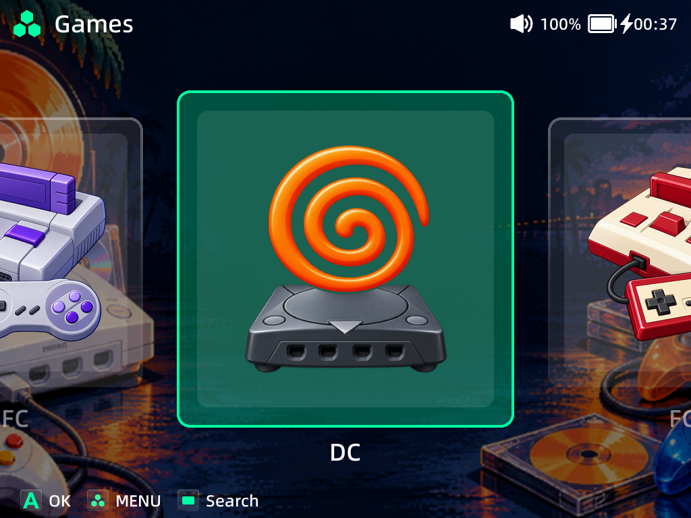 | 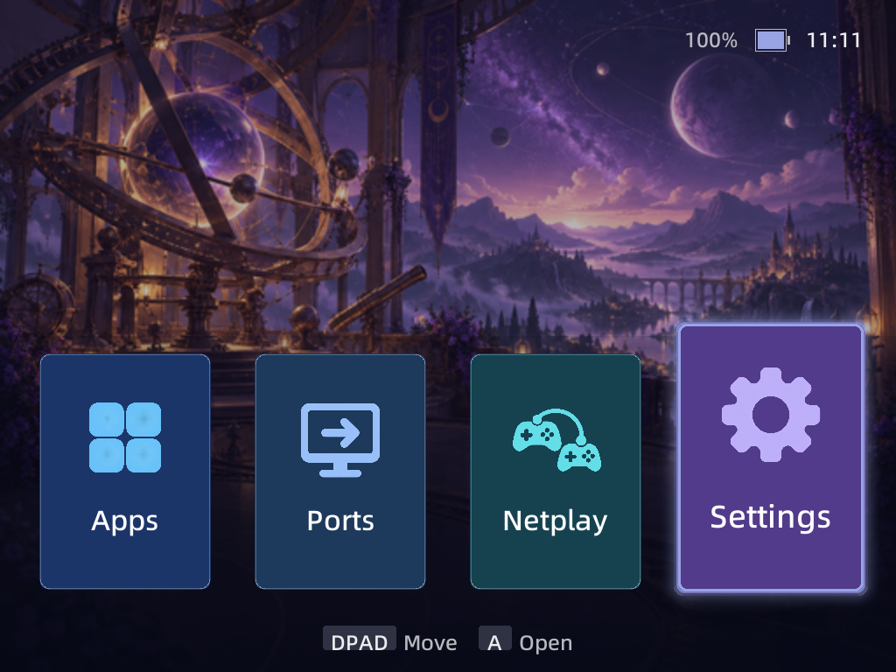 |

*Stock++ Games screen — 12 October; BrickOS desktop — 13 October 2026.
Both are presentations of the BrickOS frontend. The Stock++ screenshot uses
the theme installed on the capture device.*

The BrickOS presentation adds configurable accent colours, background darkness,
fonts, text size, card shape, wallpaper dimming, focus effects and animation
speed. Game lists, Recent and Favorites can use List, Grid or Carousel views.
**START** cycles the layout in those lists. Homepage settings select the initial
destination, including GameSwitcher or the last view used.

| Stock++: installed theme selection | BrickOS: appearance controls |
| --- | --- |
| 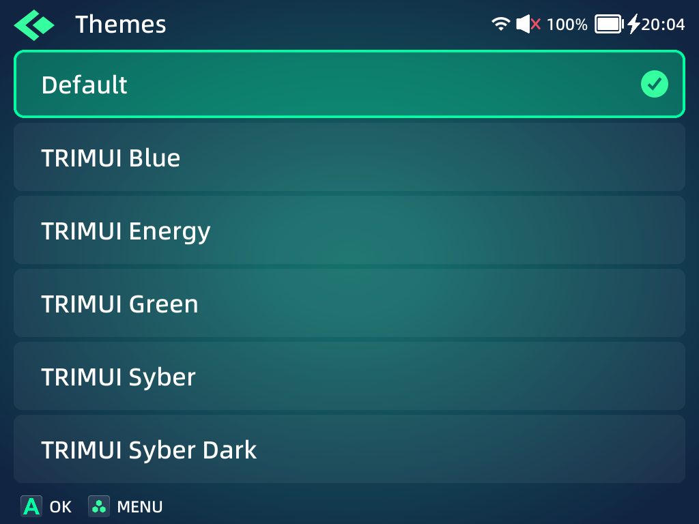 | 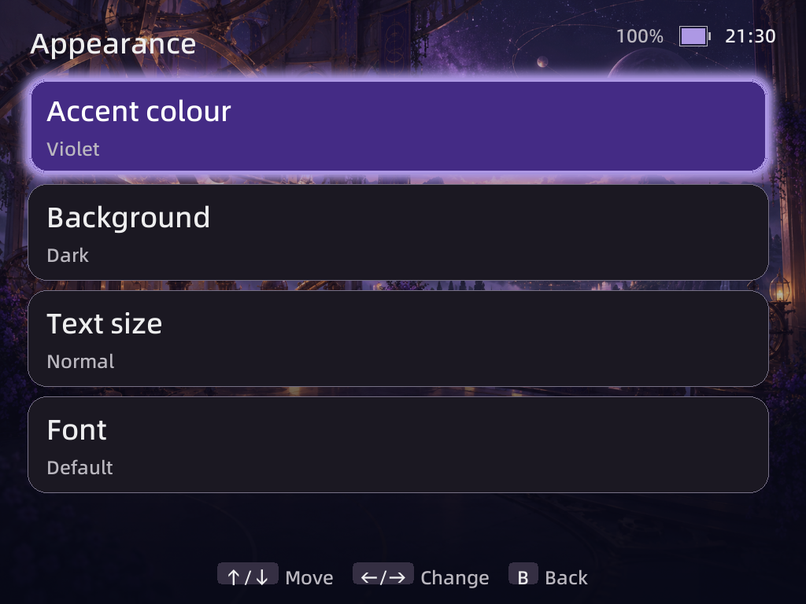 |

*Stock++ theme selection — 1 October; experimental BrickOS Appearance — 10 October 2026.*

Settings also expose button mapping, the additional LED policies, and separate
Bootlogo, Splashscreen and Loading Screen selectors. These use the resources on
the SD card; fonts and stock theme files remain supplied by the device.

**Custom JSON menus** work in both Stock++ and the experimental BrickOS interface.
They can add their own Settings sections or insert rows into existing sections,
with submenus, commands, toggles, choices, ranges and information fields. A row's
`execute` command runs a shell script; `load` commands can read the current value
and update the displayed state.

MainUI discovers these definitions at
`/mnt/SDCARD/BrickOS/settings/<name>/<name>.json`, or in an app's
`/mnt/SDCARD/Apps/<app>/settings.json`. Scripts run from the definition's folder,
so custom options can be added without rebuilding the frontend.


*The Updates tile is an installed script-backed Settings extension, captured
on 18 October 2026. Its outline icon follows the Stock++ Settings scale.*

| Themes and visual selectors | Bootlogo preview |
| --- | --- |
|  |  |

*18 October 2026. Browsing the preview leaves the applied image unchanged.
The Loading Screen browser has the same preview workflow; see the
[visual-resource examples](docs/improvements.md#input-leds-and-visual-resources).*

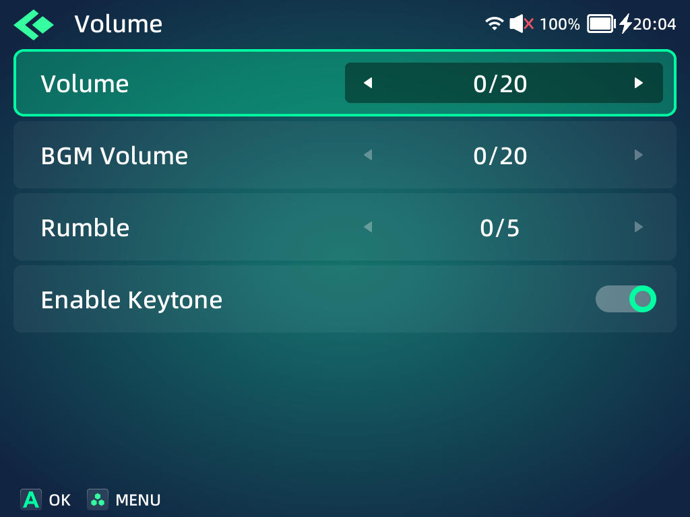

*Volume settings in Stock++ — 1 October 2026.*

| Stock++ Homepage settings | Stock++ System settings |
| --- | --- |
| 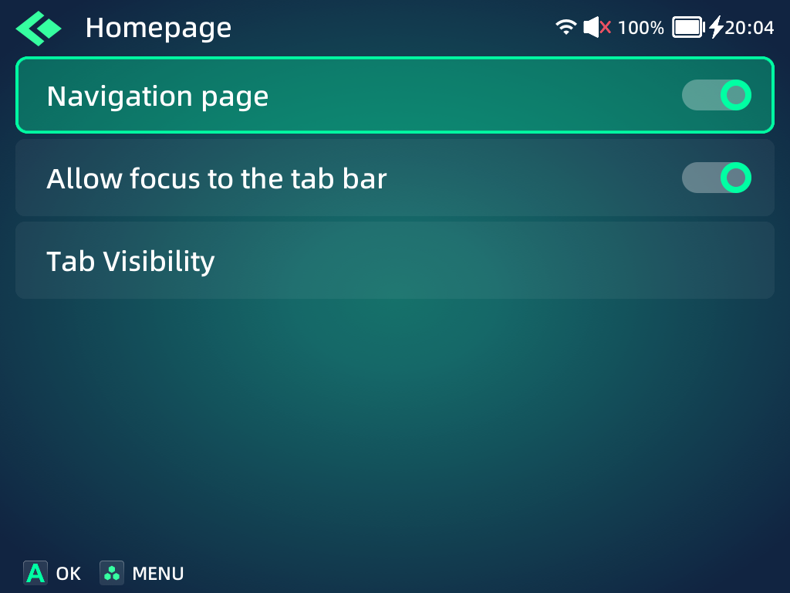 | 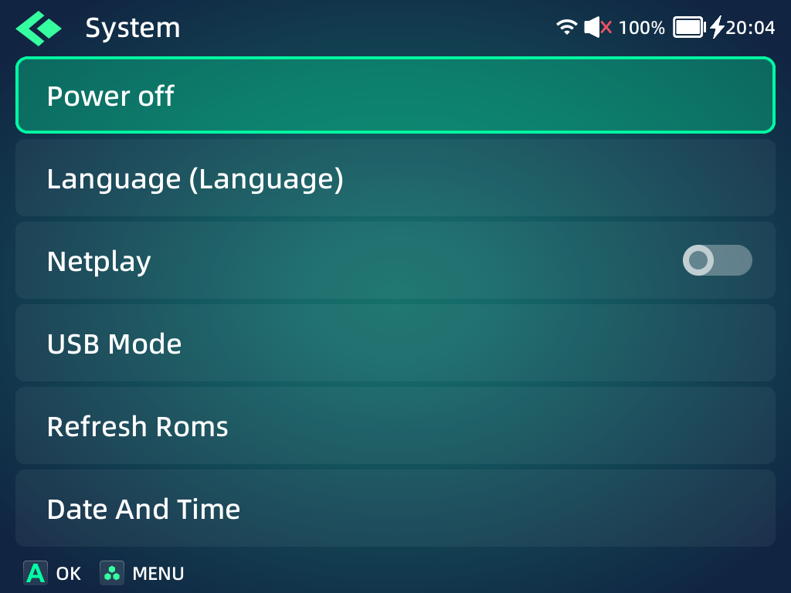 |

*Earlier Stock++ development captures — 1 October 2026.*

### Bluetooth connectivity and audio

MainUI uses the firmware's Bluetooth manager and BlueALSA. It makes the adapter
pairable while a user-requested connection runs, so the resulting bond can be
saved and the accessory can reconnect without entering pairing mode again.
It also works around the observed BlueALSA lock that could silence menu sound
or stall audio shutdown, and reopens audio when its output changes or after wake.


*18 October 2026: Redmi Buds 4 are saved but disconnected. This session captures
the available device state; it does not claim an active connection or audible
playback. The [Bluetooth details](docs/improvements.md#bluetooth-connectivity-and-menu-audio)
describe the implemented changes and remaining firmware-manager limitation.*

### Input daemon: `trimui_inputd`

The input daemon reads the physical controls and publishes the controller identity
and event codes expected by the firmware and emulators. Default mappings retain
the stock controls, including turbo, rotation and suspend handling.

BrickOS adds **Settings → Keymap → Button Mapping**: Nintendo or Xbox face-button
layouts, plus remapping or disabling Select, Start, F1, F2 and the volume buttons.
The profile applies in menus and games while the BrickOS input daemon is active.

POWER handling depends on the foreground owner. At Home, it coordinates the
BrickOS power dialog when the BrickOS OSD is running. In a managed GameSwitcher
session, it routes POWER through checkpoint saving. Other games and apps retain
the stock power path.

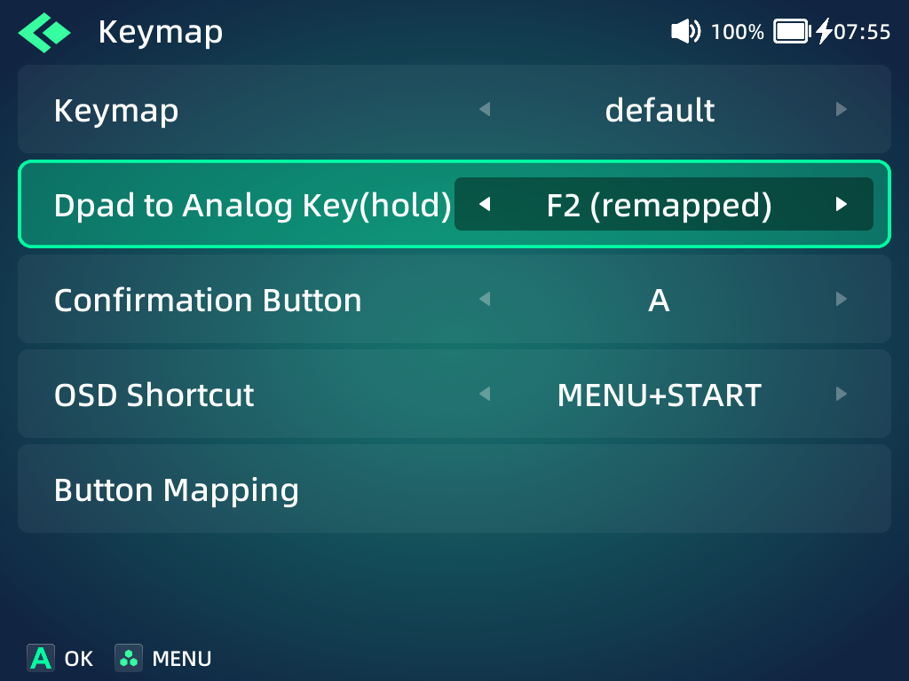

*Stock++ exposes the remapped hold button and Button Mapping entry — 9 October 2026.*


*18 October 2026: active Nintendo layout with default mappings. No mapping was
changed for this capture.*

### OSD daemon: `trimui_osdd`

The OSD renders volume and brightness notifications, information messages,
the shortcut panel, music controls and power confirmation over the frontend or
game. It consumes the firmware's existing OSD messages.

Compared with stock, it can draw those surfaces in the BrickOS style and apply
a frontend's theme profile. The BrickOS panel follows appearance colours and
shape choices. Power confirmation offers **Power off**, **Reboot** and **Cancel**;
its ownership is coordinated with inputd and MainUI.

| Stock++ shortcut-panel style | Stock++ power-confirmation style |
| --- | --- |
| 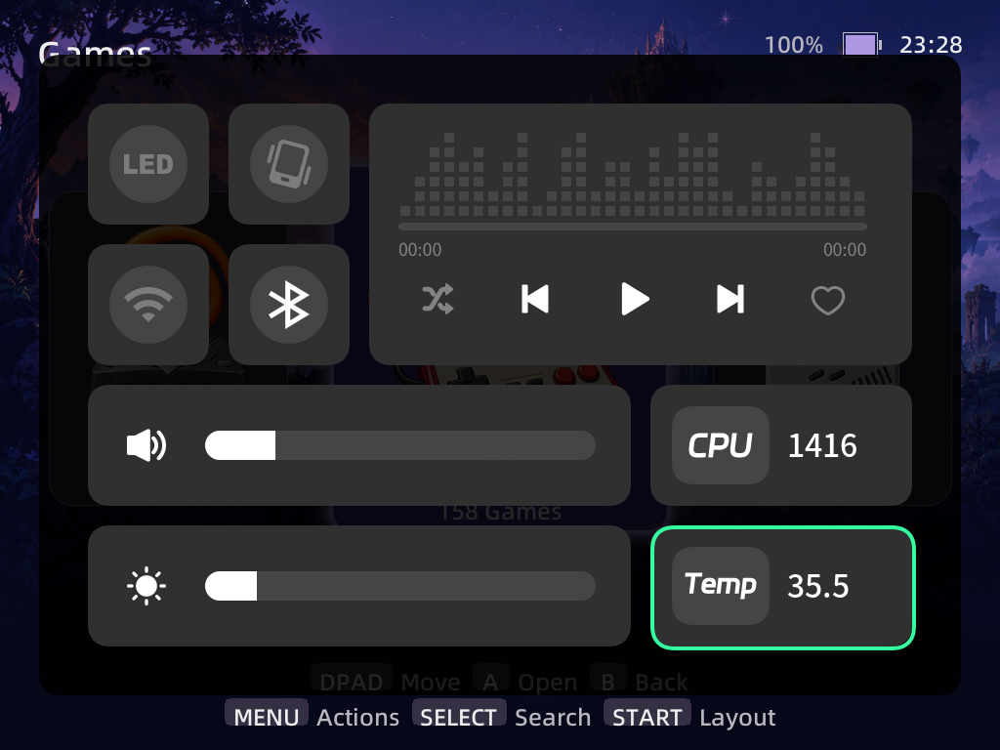 | 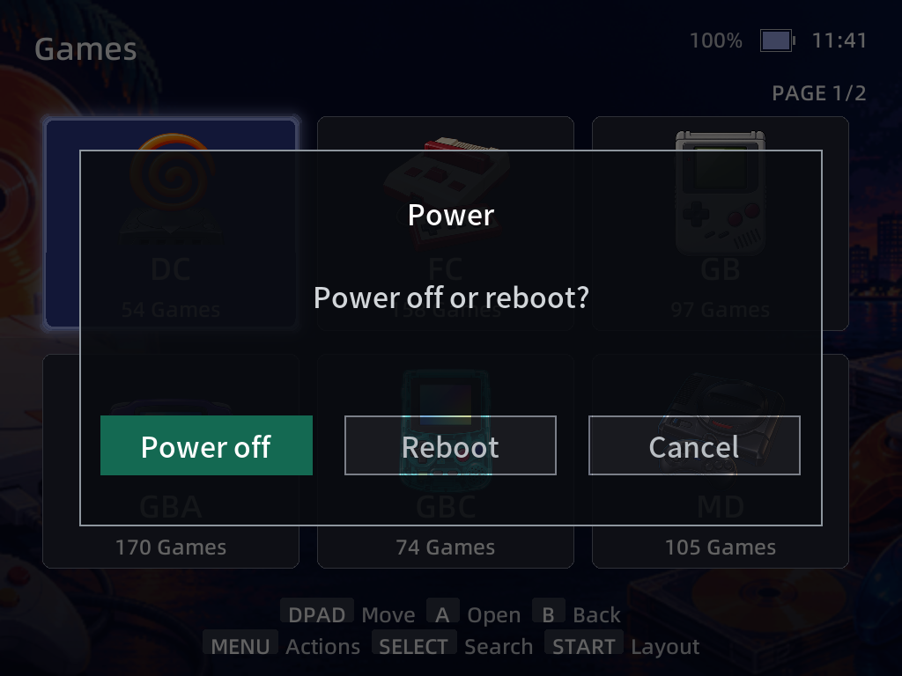 |

*Stock-style OSD panel — 9 October; power confirmation — 13 October 2026.
These show the OSD presentation; the panel capture retains the frontend that
was underneath during the style-switching session.*

### LED daemon: `brickos-ledd`

The LED daemon is an additional component. **Settings → Display → LED Policy**
retains the firmware's Default and Follow Theme choices, and adds:

- **Battery level**, **CPU speed** and **Temperature**: colour indicates the reading.
- **Charging**: a breathing battery colour while charging, and green when full.
- **Custom**: choose an effect, colour and cycle duration.

One policy applies to the top, shoulder and F1/F2 LED groups. The daemon uses the
firmware's LED effect engine and yields to standby, firmware low-battery warnings
and an active BrickTools LED daemon. Default leaves control with the firmware.
This component drives physical lights; the screen captures document the UI, not
the LEDs' emitted colours.


*18 October 2026: Custom exposes effect, colour and duration. The LEDs were off
and the original Default policy was restored after capture.*

### In-game menu: `libtmenu.so`

RetroArch loads this library and calls its menu through the existing `ShowMenu`
interface. Continue, manual Save/Load slots, Advanced Menu, Netplay and Exit Game
use RetroArch's own callbacks. BrickOS does not need to rebuild RetroArch or its
cores to provide the menu.

The library offers a BrickOS quick-menu presentation and a stock-style
presentation. Unsupported host interfaces fall back to the official library.
On ordinary supported launchers, **GUIDE** opens the menu. In a GameSwitcher-managed
game, **GUIDE + SELECT** opens it instead.

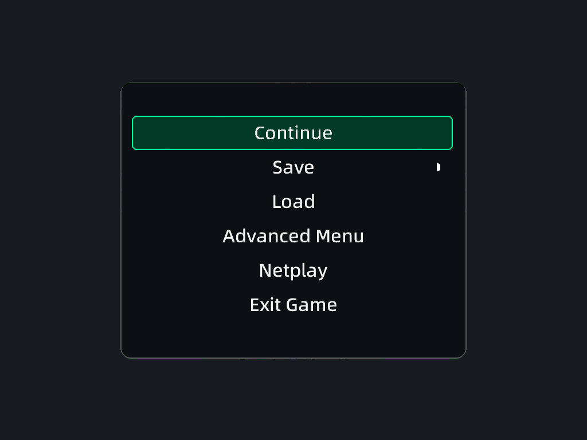

*Stock-style menu captured in RetroArch — 11 October 2026.
The game frame behind the menu is obscured for publication.*

### GameSwitcher: app, session library and supervisor

GameSwitcher adds checkpoint-based switching for compatible RetroArch launchers.
It opens from Apps or its BrickOS desktop card, showing recent games with their
last saved frame. Resuming the current game continues its existing process;
choosing another starts that game and loads its checkpoint.

It comprises three build artifacts: **GameSwitcher** draws the cards;
**`gameswitcher/libtmenu.so`** connects RetroArch's callbacks to the checkpoint
flow; **`gs-session`** supervises the game, switching, power and resume lifecycle.
Its checkpoints are separate from the menu's manual save slots.

| Control in a managed game | Action |
| --- | --- |
| GUIDE tap | Save a checkpoint, pause and open GameSwitcher |
| GUIDE double tap | Switch to the previous game |
| GUIDE + SELECT | Open the manual in-game menu |
| GUIDE + START | Open the OSD panel with its default shortcut |
| Short POWER | Save before standby |
| Long POWER | Save before shutdown; boot resume uses the committed checkpoint |

In the card view, Left/Right selects a game, A resumes, B returns Home, X hides
a card, Y previews its saved frame and SELECT shows play time. Standby and time
spent in the switcher do not count as active play time. Standalone emulators,
apps and unsupported launchers keep their existing launch behavior.

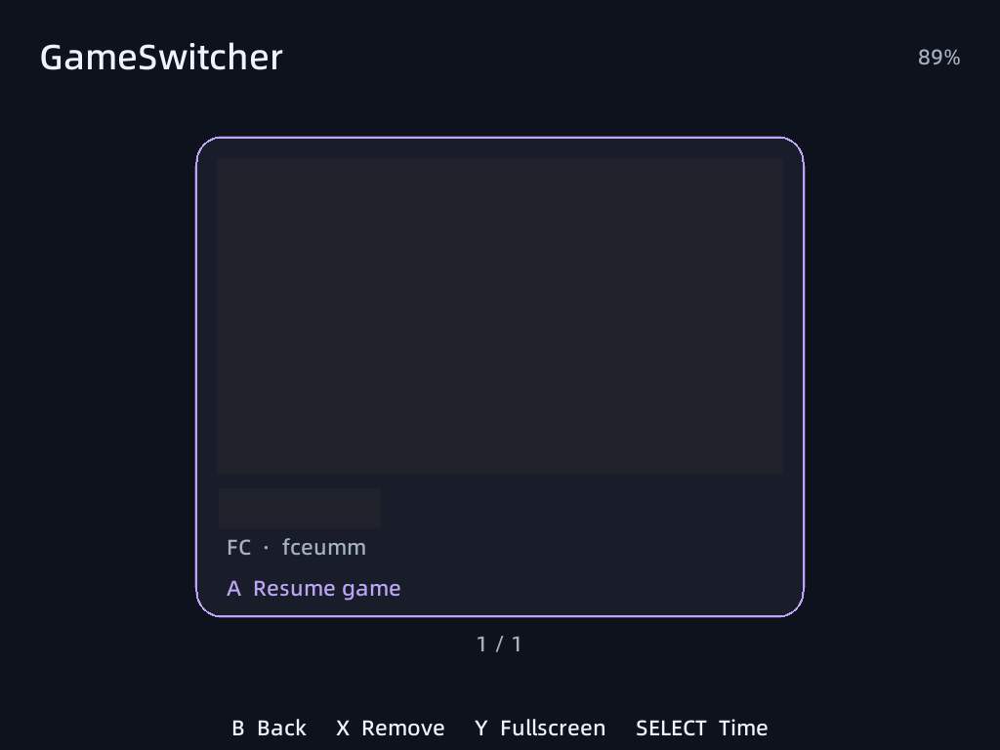

*GameSwitcher card — 13 October 2026. The game title and saved frame are obscured.*

### Setup and Uninstall BrickOS

The release ZIP includes versioned binaries, installers, startup scripts, rollback
helpers and visual resources. Extracting it to the SD card root provides the
enabled marker and startup installer. Components run from the SD card while
the existing firmware services remain available. See [release details](docs/release.md).

**Uninstall BrickOS**, in Apps, shows what will be removed before confirmation.
It schedules removal during the next restart, restores the launchers it owns and
removes the entire BrickOS folder, including GameSwitcher checkpoints and BrickOS
settings. Games, ordinary saves, Favorites, Recent, other apps and themes remain;
the last applied bootlogo and splash also remain. This full removal differs from
component rollback, which retains component user data.

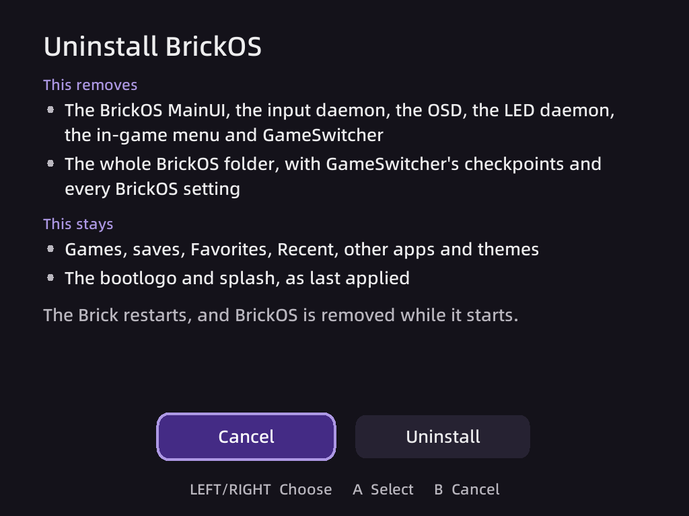

*Removal confirmation with Cancel selected — 11 October 2026.*

## Build

Docker Desktop or Docker Engine and Node.js are required. The toolchain and SDK
are downloaded inside Docker. Node.js generates the component version header
before compilation and packages releases.

Windows PowerShell:

```powershell
powershell -ExecutionPolicy Bypass -File scripts/build.ps1
```

Linux, WSL with Docker integration, or Git Bash:

```sh
sh scripts/build.sh
```

The Docker recipe uses TrimUI SDK release `20231018`, Linaro GCC `7.5.0` and
SDL2 `2.26.1`. Build outputs go to the ignored `bin/` folder:

| Artifact | Component |
| --- | --- |
| `bin/MainUI` | Frontend |
| `bin/trimui_inputd` | Input daemon |
| `bin/trimui_osdd` | On-screen display daemon |
| `bin/brickos-ledd` | LED daemon |
| `bin/tmenu/libtmenu.so` | In-game menu |
| `bin/gameswitcher/GameSwitcher` | GameSwitcher app |
| `bin/gameswitcher/libtmenu.so` | GameSwitcher session library |
| `bin/gameswitcher/gs-session` | GameSwitcher session supervisor |
| `bin/brickos-uninstall` | Removal app executable |
| `bin/brickos-update` | GitHub release updater and installed versions |

The build checks ELF64/AArch64, target dynamic dependencies and menu library
exports. It compiles the ten runtime artifacts listed above.

## Updates and component versions

**Settings → Updates** is available in Stock++ and BrickOS. It checks the public
GitHub repository automatically at frontend startup and every six hours. A new
stable release raises a notification; **Install update** asks for confirmation
before downloading. The verified package is applied at the next normal boot.
Wi-Fi, HTTPS-capable curl and a valid CA trust store are required on the device.
See [GitHub updates](docs/updates.md) for details.

The menu shows the installed release and the versions of all ten components.
Versions are maintained explicitly in `versions.json`; build IDs and SHA-256
hashes identify exact package contents. See [component versions](docs/component-versions.md)
for version changes and release comparison checks.

| Updates custom menu | Component versions submenu |
| --- | --- |
|  | 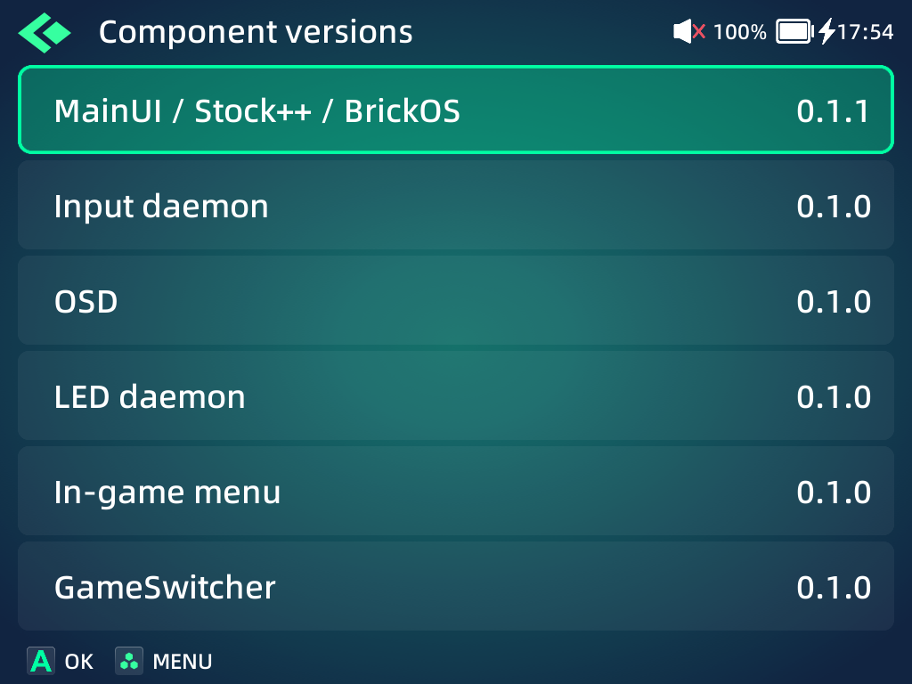 |

*18 October 2026. Wi-Fi was disabled, so Updates shows its offline retry state.
No update was downloaded or installed during this documentation session.*

## Release package

With Docker and Node.js installed, build and package a release:

```powershell
powershell -ExecutionPolicy Bypass -File scripts/release.ps1
```

```sh
sh scripts/release.sh
```

The ZIP is written to the ignored `dist/` folder. It includes runtime binaries,
installers, startup scripts, removal helpers, bootlogos, splashscreens, loading
screens, settings icons and wallpapers. See [release details](docs/release.md).

## License

BrickOS is released under the [Apache License 2.0](LICENSE). The generated pinyin
table derives from Unicode 5.2 Unihan; its [attribution](data/mainui-pinyin/README.md)
and [Unicode license](data/mainui-pinyin/LICENSE.txt) accompany the source.
