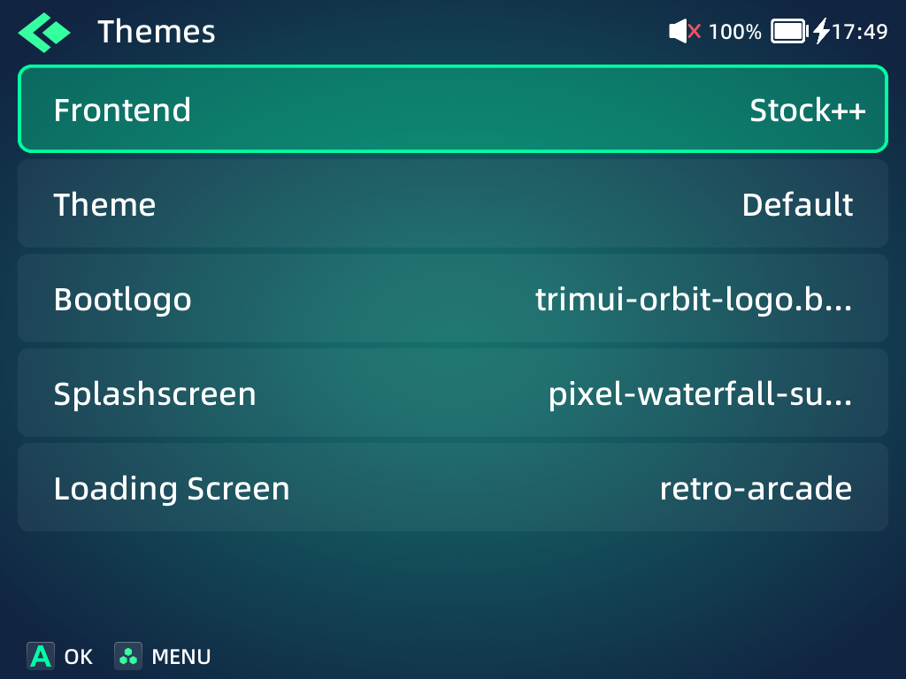
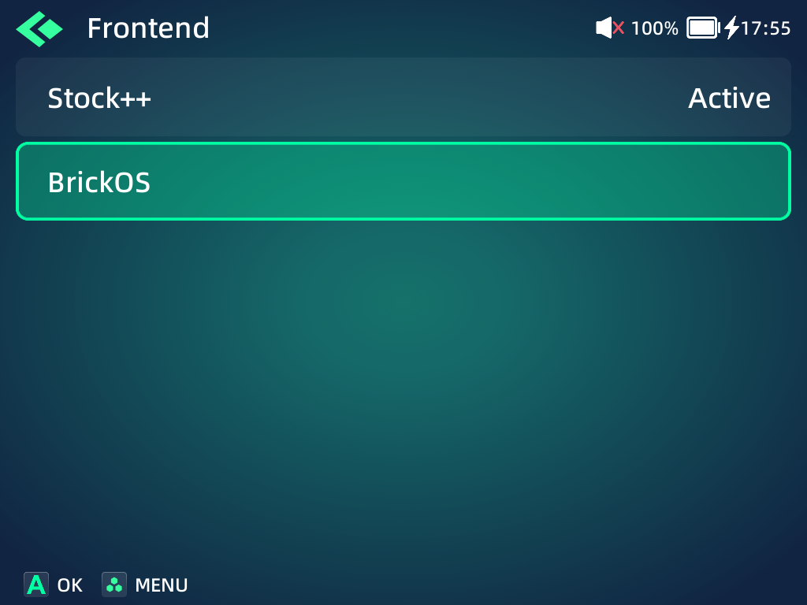
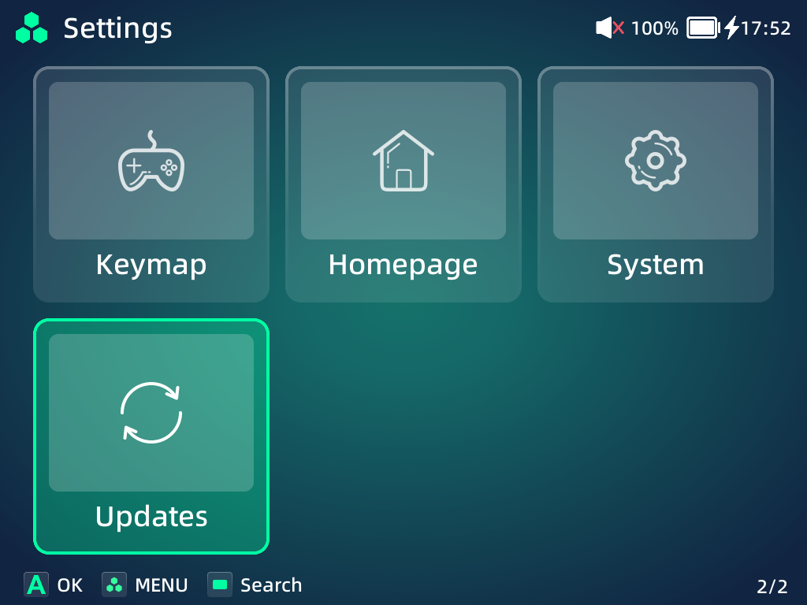
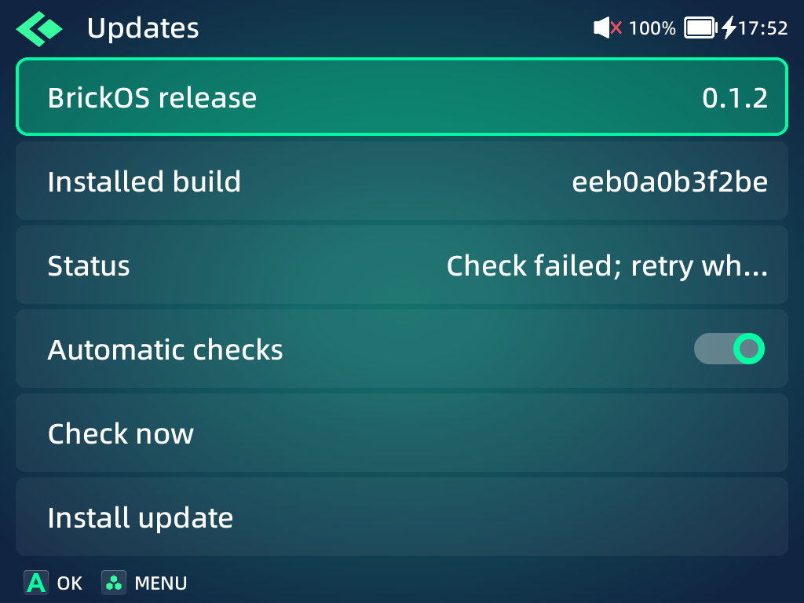
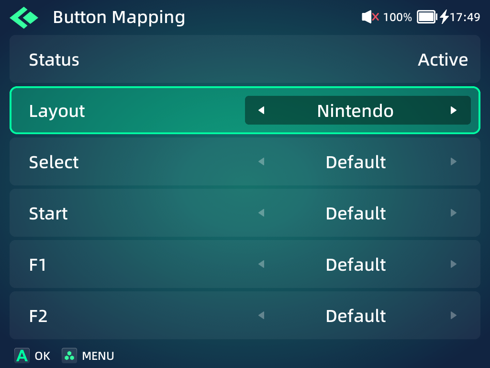
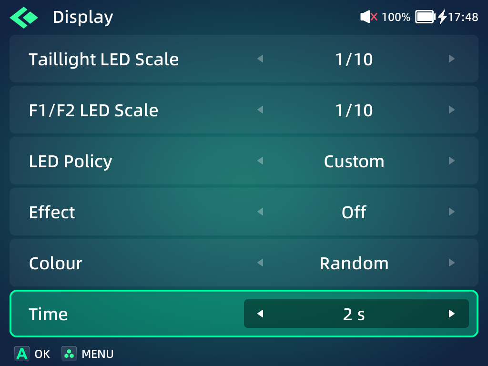
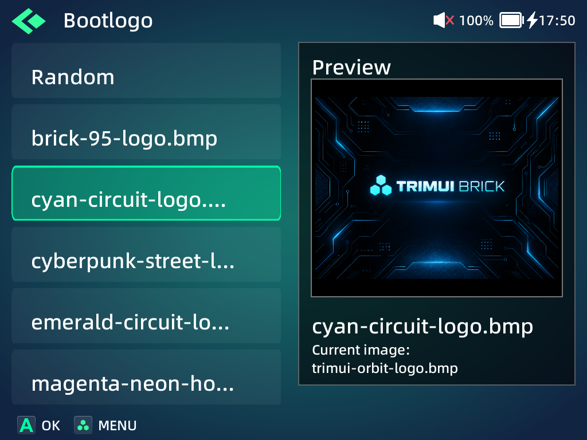
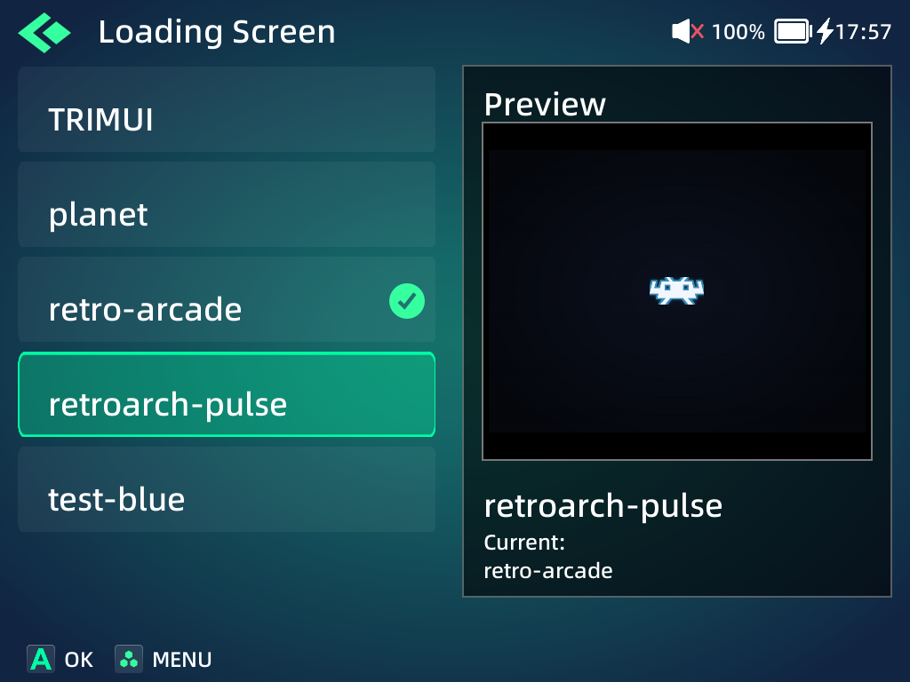
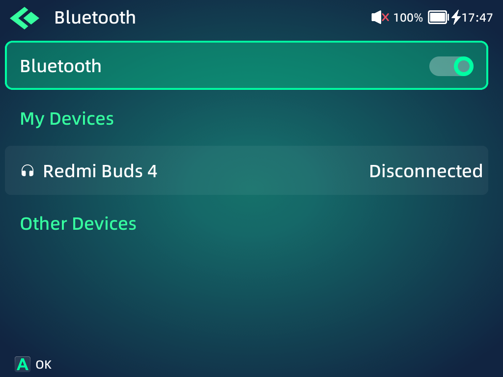

# Improvements over the stock frontend

Stock++ is the enhanced stock-style presentation of the reimplemented MainUI.
It provides 100% functional parity with the original frontend and extends it with
the capabilities below. BrickOS is the experimental alternative frontend we are
developing; both presentations share MainUI and the same device integrations.
These are development builds running alongside the original firmware services.

| Stock++ visual settings | Frontend selection |
| --- | --- |
|  |  |

The selector capture focuses BrickOS while Stock++ remains active; no frontend
change was confirmed for the capture.

## New capabilities

| Area | What BrickOS adds | Where to find it |
| --- | --- | --- |
| Custom menus | JSON-defined Settings tiles, submenus and rows inserted into existing sections; commands, toggles, choices, ranges and live information supplied by scripts | `BrickOS/settings/<name>/<name>.json` or an app's `settings.json` |
| Button mapping | Nintendo/Xbox layouts and remapping or disabling Select, Start, F1/F2 and volume buttons | Settings → Keymap → Button Mapping |
| LEDs | Battery, CPU, temperature and charging policies, plus custom effect, colour and cycle duration | Settings → Display → LED Policy |
| Boot visuals | Independent bootlogo and splashscreen browsers with previews, applied-image identification and Random mode | Settings → Themes |
| Loading screens | Browse and preview RetroArch loading-screen presets, with verified replacement of a complete preset | Settings → Themes → Loading Screen |
| Updates | Automatic checks of the public GitHub repository; confirmation before downloading, validation and installation at the next normal boot | Settings → Updates |
| Component versions | A release version and separate versions for ten components, alongside exact build IDs and file hashes | Settings → Updates → Component versions |
| GameSwitcher | Checkpoints, recent-game cards, quick switching, active play time and save-aware power handling for compatible RetroArch games. It can be turned off, GUIDE can open the in-game menu instead, systems can be excluded, and the history can be limited, cleared or measured | Apps → GameSwitcher; GUIDE in a managed game; Settings → GameSwitcher |
| Experimental frontend | Alternative desktop, appearance controls and configurable list/grid/carousel views | Settings → Themes → Frontend → BrickOS |

### Script-backed Settings

The installed Updates section is a working JSON extension. Its information rows
load installed metadata, its toggle controls automatic checks, its commands check
or prepare a release, and its submenu lists component versions. Extensions can
also add rows to built-in sections without recompiling MainUI.

| Settings tile | JSON extension running on the device |
| --- | --- |
|  |  |

See [custom menus](custom-menus.md) for a complete example, row types, script
arguments, live values, confirmation and cancellation. Scripts execute with the
same device privileges as an app; only install definitions and scripts you trust.

### Input, LEDs and visual resources

| Button Mapping | Custom LED options |
| --- | --- |
|  |  |

The mapping capture shows the active Nintendo/default profile. The LED capture
temporarily selects Custom to expose its fields; the original Default policy was
restored afterwards. The screen documents controls, not emitted LED colours.

| Bootlogo preview | Loading-screen preview |
| --- | --- |
|  |  |

Browsing a preview does not apply it. These captures leave the previously applied
bootlogo, splashscreen and loading preset selected. Bootlogo and splashscreen
Random modes are independent; applying a selection affects the corresponding
firmware consumer at a later boot. The frontend does not reboot automatically.
The list also reflects additional presets present on the reference SD card.
An applied loading-screen preset is used on a subsequent RetroArch game launch.

## Bluetooth connectivity and menu audio

The stock Bluetooth manager and BlueALSA remain in use. MainUI changes how it
coordinates pairing, saved-device state and its own audio:

- **Persistent pairing:** while a user-requested connection is pending, the
  adapter is temporarily pairable so a bond/link key can be stored. Pairable mode
  ends after the attempt, on timeout or when Bluetooth is turned off. This repairs
  the observed stock behaviour where a saved accessory needed pairing mode again.
- **Accessory reconnection:** a bonded accessory can reconnect when it becomes
  available. MainUI monitors saved-device state; it does not repeatedly send
  automatic connection requests to absent devices.
- **Headphone menu audio:** the frontend works around the observed BlueALSA PCM
  lock that could silence clicks/music or stall audio shutdown. Startup waits
  briefly for the saved-device list before choosing an already connected output;
  output changes, wake and lost-audio recovery reopen the appropriate route.
- **Connection feedback:** My Devices and Other Devices retain the stock UI;
  manager replies update connection state, and failed attempts show feedback.

The 18 October capture shows saved **Redmi Buds 4**, currently **Disconnected**.
No accessory was connected for this documentation session. This image demonstrates
the saved-device UI; it does not establish successful reconnection or audible
playback. The pairing/audio improvements are implemented in
[frontend.c](../src/mainui/frontend.c), [audio.c](../src/mainui/audio.c) and
[main.c](../src/mainui/main.c), with earlier device observations recorded during
development. Compatibility still depends on the accessory and firmware stack.
The firmware manager can remain busy for roughly 2.5 minutes when a requested
device does not answer; that inherited limitation is not removed here.

## Corrections to observed stock behaviour

| Area | Observed stock problem | Replacement behaviour |
| --- | --- | --- |
| Wi-Fi credentials | Editing the password for the connected network could report success using the existing connection | Disconnects and reconnects with the new credentials; rejected credentials report failure |
| Wi-Fi timing | A valid connection could complete after the UI had already reported failure | Waits for up to 30 status readings and ends the wait when connected |
| Wi-Fi after a reboot | With Wi-Fi on, the device rejoined the network at boot but nothing started its DHCP client, so it had no address and network features such as update checks failed until Wi-Fi was turned off and on | Starts the DHCP client when the Wi-Fi client is running without one |
| Search and counts | Systems with an empty index/list cache could be omitted from search or have no game count | Searches all systems and counts every displayed system |
| UTF-8 editing | Delete removed one byte, potentially corrupting a multi-byte character | Removes a complete UTF-8 code point |
| Visibility edits | Cancel could still save Games/Apps visibility changes | Discards the edits and reloads the persisted catalog |
| Focus and paging | START on the tab bar could show two focuses; a final ROM-group jump could scroll the selection away | Retains one active focus and keeps group endpoints visible |
| Bests | A single surviving tile could be clipped off-screen | Centers that tile while retaining navigation |
| Netplay covers | Downloaded covers could appear black after texture creation in the worker thread failed | Downloads in the background and creates textures on the rendering thread |
| Clock | Noon could be labelled AM in 12-hour mode | Displays 12:00–12:59 as PM |
| Failed handoffs | A refused launch-command write could still close the frontend | Keeps the current screen usable and clears stale launch handoffs |
| Rumble preview | Failure to start a replacement timer could leave an owned pulse enabled | Stops the owned pulse on that failure |

These are implemented behaviour changes, rather than claims that each case was
reproduced during this photo session. The relevant public implementation is in
[MainUI](../src/mainui/), including its model, catalog, keyboard, service adapters
and rendering code. The current screenshots illustrate the UI; they are not
before/after timing, radio or physical-input tests.

## Reliability of the added components

The replacement components also include development fixes: the OSD supervisor
detects a loop counter that stops advancing and recovers/falls back; GameSwitcher
handles replacement of the input controller, keeps volume controls available in
its card view, and reserves boot resume for a committed long-POWER shutdown. It now
takes every compatible RetroArch launcher, including a system's other emulators, so
systems such as Mega Drive and Super Famicom use it too. The updater verifies GitHub with
the firmware's CA bundle and retries a failed automatic check after a minute. Its
notification and long Settings confirmations now show their whole text instead of
ending with "...". The input daemon now finds MainUI and the OSD by rechecking the
processes it already found. It used to scan every process 20 times a second, which took
about half a CPU core and kept the processor at full speed at Home.
The in-game menu keeps focus on Save after saving. These improve BrickOS's own
components; they are not presented as defects in equivalent stock features.

The kernel, radio/display drivers, RetroArch and emulator cores remain supplied
by the device. In particular, this frontend does not repair the firmware's
observed framebuffer-driver deadlock. Physical suspend, power, accessory and
game compatibility remain distinct from what a Settings screenshot can show.

## Capture context

The new images on this page were captured directly from the reference TrimUI
Brick on **18 October 2026**, at **1024 × 768**, in **Stock++**, running release
**0.1.2**, package **eeb0a0b3f2be** (MainUI **0.1.1**, updater **0.1.1**).
Wi-Fi was disabled. No update was downloaded, no Bluetooth device was paired or
removed, and no boot visual was applied. See [screenshot provenance](screenshots.md).
